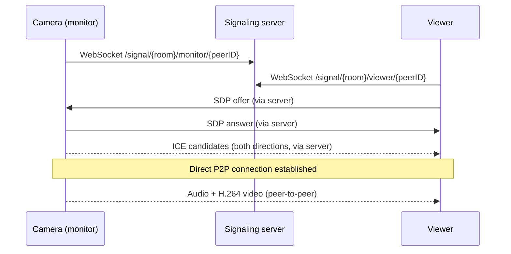

# iWebRTCMonitor

**A peer-to-peer video monitor for iOS and macOS, built with SwiftUI and WebRTC.**
One device streams live camera and audio, another watches it. Video goes directly between the devices; a small WebSocket server is only used to set up the connection.

> Portfolio project · [Roadmap](ROADMAP.md) · [License](#license)

## What this project demonstrates

- **Real-time video between devices.** Live camera and audio stream from one device to another over WebRTC, the same technology behind video calls in browsers and messengers.
- **Peer-to-peer, privacy-friendly design.** Video goes straight from device to device. The server only helps the two sides find each other and never sees the media.
- **One codebase for iPhone, iPad and Mac.** A single SwiftUI app with native platform pieces where they matter (camera, video rendering, QR scanning).
- **Reliable, thread-safe networking.** Modern Swift concurrency with clear ownership of every connection, so reconnects and overlapping events do not cause crashes or stuck sessions.
- **Tested and debugged at a low level.** Automated tests against a local WebSocket server, plus a custom WebRTC build that was used to find and avoid H.264 encoder problems (see [Why a custom WebRTC build](#why-a-custom-webrtc-build)).

<!-- ## Demo on platforms

### macOS


### iOS
 -->

---

## What it does

- **Two roles in one app.** *Camera* captures and streams. *Viewer* receives.
- **Pairing with a QR code.** The Camera creates a room and shows a QR code with a deep link (`<bundle id>://join?roomID=...`). The Viewer scans it, or types the Room ID. Recently used rooms are stored in memory.
- **Peer-to-peer media.** Audio and video go straight between devices over WebRTC. The server never sees the media.
- **One camera, several viewers.** The session layer keeps a separate peer connection for each viewer.
- **Camera control.** Switch between available capture devices. Capture format follows the video levels the peers negotiate.
- **H.264 level diagnostics.** The app reads the negotiated H.264 levels from the SDP and adjusts capture resolution and frame rate to match. This avoids encoder failures on weaker receivers.
- **Debug tools.** In Debug builds an on-screen log overlay shows signaling and WebRTC events, so connection problems are visible without Xcode attached.
- **iOS and macOS** from one SwiftUI codebase, with platform-specific wrappers where needed (`UIViewRepresentable` / `NSViewRepresentable` for video rendering and QR scanning).

## How it works



### Architecture

```
App/            Entry point, platform app delegates
Views/          SwiftUI screens: Lobby, Rooms, Camera, Viewer, RTCView wrappers, debug overlay
ViewModel/      ContentViewModel, RoomViewModel, ViewerViewModel (UI state, navigation)
Networking/
  SessionManager      One room session: owns signaling, local media, peer clients, ICE buffers
  SignalingClient     WebSocket connection to the signaling server, stale-connection protection
  WebRTC/
    WebRTCClient            One RTCPeerConnection per peer
    WebRTCLocal             Shared factory, camera capturer, local audio/video tracks
    PeerConnectionDelegate  Bridges native WebRTC callbacks
Diagnostics/    H.264 level parsing, encoder tracking
Helpers/        Logger with categories and in-app log handler
```

Design decisions worth knowing:

- **Explicit threading.** `SessionManager` owns a serial queue. Socket and WebRTC callbacks hop onto it before touching session state. Every core type documents who owns it and which queue it must be used on.
- **Stale-connection protection.** `SignalingClient` ignores callbacks and sends from connections that have already been replaced.
- **ICE candidate buffering.** Candidates that arrive before the remote description is set are held and applied afterwards (covered by tests).
- **UI state on the main actor.** View models run on `MainActor`, and session callbacks transfer updates there.

## Requirements

| | |
|---|---|
| Xcode | 26.5+ |
| iOS / iPadOS | 16.6+ |
| macOS | 14.6+ |
| Docker | Optional, for the sample signaling server |
| Physical device | Either iPhone or MacBook recommended for the Camera role (the simulator has no camera, and audio capture is disabled there) |

## Quick start

### 1. Get the WebRTC library

The project is linked with working **0.1.0-m156** release artifacts of my [WebRTCLibrary public github repo](https://github.com/k-dev/WebRTCLibrary).

The project depends on a WebRTC build (Chromium branch **M156**). See [Why a custom WebRTC build](#why-a-custom-webrtc-build) for why I build it myself.

### 2. Start the signaling server

```bash
docker compose up signaling
```

The server listens on port `8080`. The compose file uses a prebuilt Vapor-based image (`kirillthedev/swift-webrtc-signaling`).

### 3. Point the app at the server

To get your machine `IP-address` run this command in **Terminal**:
```bash
ifconfig | grep "inet " | grep -v 127.0.0.1
```

Then use obtained IP as WebSocket URL `ws://<YOUR_IP>:8080` (e.g. `ws://192.168.0.92:8080`) in an app:

1. **Build setting.** Define `SERVER_URL` (for example in an `.xcconfig` file or in the target's Build Settings). `Info.plist` reads it through the `ServerURL` key.
2. **Info.plist.** Replace the `$(SERVER_URL)` value of the `ServerURL` key with your address.
3. **In the app.** Open **Settings** on the main screen and edit *Signaling Server Address*.

If the address is empty or wrong, the app cannot connect. Plain `ws://` may need an App Transport Security exception on Apple platforms; use `wss://` behind TLS for anything beyond local testing.

### 4. Run

**Signing and bundle ID.** In Xcode, select your own **Team** under **Signing & Capabilities** and set your own **Bundle Identifier**. Use the same bundle ID for the Camera and Viewer builds: the app generates QR deep links as `<bundle id>://join?roomID=...` and registers that bundle ID as its URL scheme. If the bundle IDs differ, the Camera’s QR link will not open the Viewer app; enter the Room ID manually instead.

1. Build and run on device A, choose **Camera**. Grant camera and microphone access. A QR code appears.
2. Build and run on device B (or a Mac), choose **Viewer**, scan the QR code or enter the Room ID.
3. Open the Camera **first**, then the Viewer (see limitations).

## Tests

```bash
xcodebuild test -scheme iWebRTCMonitor -destination 'platform=iOS Simulator,name=iPhone 16'
```

Unit tests use [Swift Testing](https://developer.apple.com/xcode/swift-testing/) and cover:

- ICE candidate buffering and ordering
- Session lifecycle (start, stop, cleanup of peers)
- Signaling connection handling, including stale connections
- SDP delivery, tested against an in-process WebSocket server (`LocalWebSocketServer`, built on `Network.framework`)
- Logger behavior

## Known limitations

Room-ID-only access, plaintext signaling, and STUN-only connectivity are known, deliberate choices for this stage of the project.

- **Room access and signaling.** Access relies solely on knowing the room ID (UUID); there is no authentication required. The sample setup uses unencrypted `ws://` signaling.
- **STUN only.** The app uses public Google STUN servers without a TURN relay. Connections can fail behind strict NATs or on some mobile networks.
- **WebRTC build.** The app targets WebRTC branch M156 (see [Chromium Dash](https://chromiumdash.appspot.com/branches) for current stable branches). Details below.
- This repository is a reference project.

### Why a custom WebRTC build

The app uses my own WebRTC build, published as [WebRTCLibrary](https://github.com/k-dev/WebRTCLibrary), instead of a ready-made package. There were two reasons:

1. **Intel Mac support.** Some publicly available WebRTC packages ship no macOS `x86_64` slice, so the app could not run on Intel Macs. Building WebRTC from source gave macOS binaries for both Apple Silicon and Intel.
2. **Debuggable codec behavior.** With my own build I could debug inside the native WebRTC code. That is how I found problems in the **M153** branch with the H.264 codec and with the fallback to VP8, which is encoded in software. The H.264 level handling and the encoder diagnostics in `Diagnostics/` grew out of that work.

After testing several branches, **M156** proved stable for both H.264 and the VP8 fallback, so the project is pinned to it.


Open questions and future work is tracked in [ROADMAP.md](ROADMAP.md).

## License

The core source code is **dual-licensed**:

- **GPL-3.0-or-later**: free to use under the GPL terms. See [LICENSE-GPL.txt](LICENSE-GPL.txt).
- **Commercial license**: for use in proprietary or closed-source products, or under other terms (for example MIT, Apache-2.0 or BSD). See [LICENSE-COMMERCIAL.txt](LICENSE-COMMERCIAL.txt) and [LICENSE.txt](LICENSE.txt).

*For commercial licensing contact me at kirillthedev at gmail.com*

Third-party components (WebRTC and others) keep their own licenses. See [NOTICE.txt](NOTICE.txt).
